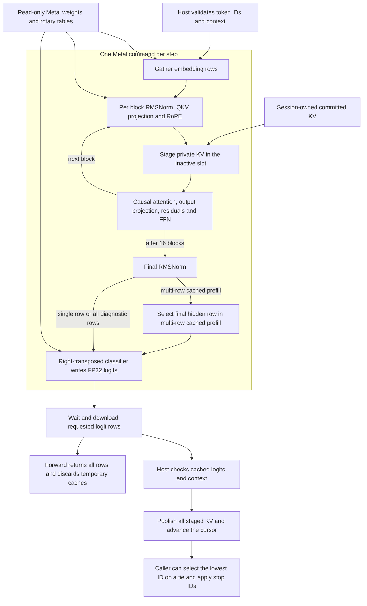

# Resident FP32 Metal inference

LL-03 extends the existing `LoadHFModelMetalAttention` and CLI combination
`-ffn-backend metal -attention-backend metal` from embedding lookup through
the final classifier. The CPU default and FFN-only mode retain their previous
execution paths. Unsupported builds or devices return `gpu.ErrUnavailable`
through the explicit Metal loader. See [LL-02](https://github.com/itsmontoya/llama/pull/33) for
the earlier resident transformer and [NN-07](https://github.com/itsmontoya/neuralnetwork/pull/147)
for the released output primitives.

## Revisions and inputs

| Input | Identity |
| --- | --- |
| Llama base | LL-02 owner merge `7120b180d9016830c25f69dc9fe9a04d2f8b8ec6` |
| Llama implementation | `48f6b5e8ded92324681e259480245603db9737f8` on `gpu-ll-03` |
| neuralnetwork | `v0.11.2`, commit `8db36638be5b0166d676ae1322d89dd095823cb3` |
| Go module checksum | `h1:4G/3ohNq5D95cX2JWdaIDeECcQOaeZn8EP9c+SgKcxE=` |
| Go module file checksum | `h1:SafbkuDehVErsuJAL5FHFsLhKJbeh/OI3ItvbmwDafw=` |
| Llama 3.2 1B snapshot | `meta-llama/Llama-3.2-1B`, revision `4e20de362430cd3b72f300e6b0f18e50e7166e08` |
| Manifest SHA-256 | `3404dfda97c69cf3a9a3cf15dc4db7017cb049da07462c52f2e3004f6e12ab64` |
| Frozen reference SHA-256 | `3a66ddc5cbdef45e397e47a6bd992676ab3d35234a8b389908f721b05466d361` |
| Model safetensors SHA-256 | `68a2e4be76fa709455a60272fba8e512c02d81c46e6c671cc9449e374fd6809a` |
| TinyStories 260K SHA-256 | `b0a507e7ad0f626624f17112325e66691f9076d622e1d3274d103d00299f2696` |
| TinyStories vocabulary SHA-256 | `037cb335abb25d1fa9e8ecae30ed2a3a8ace9302862ebcdc05d51a6bbb10c312` |

The Go module download verified the tag's origin and both checksums.
The released Git tree matches the tested NN-07 tree
`3f5fd0c42152435904d0c613a49b70bd174d03a2`. The pinned fixture tests
verified all six snapshot files against the manifest before loading.
[Fixture setup and provenance](testdata/README.md)

## Residency and publication



The tied embedding and classifier share one immutable `[128256,2048]`
row-major tensor of 1,050,673,152 bytes. The loader registers it once for
release and retains no host counterpart. Untied checkpoints upload each
matrix once into its own allocation. BF16 conversion still builds a
temporary FP32 host slice per weight. The largest is the embedding itself.
Q/K row interleaving requires an additional temporary FP32 copy for the
current weight. Safetensors file reads use 64 KiB of scratch. RSS also
includes host heap retention, native driver pages and mapped shared memory.

Callers receive their own logits. A cached step downloads
513,024 bytes directly into its returned slice, validates all values as
finite, and checks context before publication. A full-prefix `Forward`
requests all rows and copies the downloaded slice into a host-owned
`tensor.Tensor`. `ForwardWithTrace` uses materialized attention probabilities
and remains available through the CPU and FFN-only loaders.

Each model owns one logical device. Separate models share the default
native runtime and queue. Each session owns its cache, and each call owns
its scratch and scopes. A copied Metal decoder or session handle shares
the original lifetime. Model and session locks exclude resets and closes
through publication. A canceled submitted command drains before freeing
scratch. Any failure before publication discards staged updates so retry
starts from the same position. Recovery assumes the Metal device stays usable.
[Released KV staging contract](https://github.com/itsmontoya/neuralnetwork/blob/8db36638be5b0166d676ae1322d89dd095823cb3/docs/gpu-attention.md#staging-and-publication)

For this model, every step encodes 242 compute dispatches. There are 17
blit encoders on decode and full prefix, and 18 on cached prefill with
more than one token. The 16 KV blits preserve each committed prefix,
the embedding blit copies the requested rows, and the optional prefill
blit selects the final normalized hidden row. Each step submits and awaits
one command, with the logit row as its only host transfer.
In the eight-output workload the 13 processed input tokens gather 106,496
bytes on-device, and the optional final-row gather copies 8,192 bytes.
KV blits copy 4,128,768 committed bytes and 851,968 new bytes across eight
steps. Eight logit downloads read 4,104,192 bytes in total.

Model weights and rotary tables request 4,943,388,672 device bytes at
context 512. A session requests 1,703,936 KV bytes at capacity 13 and
67,108,864 bytes at capacity 512. Transient scratch requests 683,008
bytes at M=1, 1,541,120 at six-token cached prefill, and 5,450,752 at
29-token cached prefill. A six-token prefill with capacity 13 requests
4,946,633,728 total live model, KV, and scratch bytes in one session.
Requested device bytes and process RSS can overlap on unified memory.

## Correctness and verification

On Apple M3, the resident path produced prompt IDs
`[128000 791 6864 315 9822 374]` and exact output IDs
`[12366 13 1102 374 279 1455 95551 3363]`. Both CLI modes printed
`" Paris. It is the most populous city\n"`. At position 11, ID 95551
won by 0.0433101654 versus 0.043340683 in the frozen reference.
The maximum sampled logit error was 4.76837158e-5. The worst tolerance
fraction was 0.0207613404 under the unchanged
`1e-3 + 1e-3*abs(reference)` bound.

Cached and full-prefix Metal agreed on every compared logit for the
eight-step replay, the 27/28/29-row tails, and the terminal row of the
32-decode trace through positions 6–37, with zero maximum observed error.
The complete 33-selection sequence matched the host trajectory. Two
sessions sharing a model and two independent decoders also passed. Cached
and uncached generation stopped before ID 13 and respected context limits.

The largest synthetic logit errors against FP64 were 1.32635036e-7 for
MHA, 3.55690955e-7 for GQA and 2.11095269e-7 for MQA under the existing
`2e-5 + 2e-5*abs(reference)` bound. Tests cover exact classifier ties,
two untied matrices, tied release ownership, partial load failure,
failed final-layer and classifier recording, nonfinite logits after
a successful command, canceled waits, retry with a different token,
copied handles, and close during an active step.

Run from the repository root with the directory variables pointing at the
verified fixtures. The full native run and the default run use the 1B
checkpoint and TinyStories. The remaining commands use TinyStories where
applicable. Run large-model test packages and benchmark binaries serially.

```sh
export GOWORK=off GOMAXPROCS=8 GOARM64=v8.0
export LLAMA_STORIES260K_MODEL="$stories_dir/stories260K.bin"
export LLAMA_STORIES260K_TOKENIZER="$stories_dir/tok512.bin"
go mod download -json github.com/itsmontoya/neuralnetwork@v0.11.2
go mod verify
go fmt ./...
go vet ./...
env LLAMA_32_1B_MODEL_DIR="$model_dir" go test -p 1 -count=1 -timeout 20m -v ./...
go test -p 1 -count=1 -race -v ./...
CGO_ENABLED=0 go test -p 1 -count=1 ./...
CGO_ENABLED=0 go test -p 1 -count=1 -tags=purego ./...
CGO_ENABLED=0 go test -p 1 -count=1 -tags=metal ./...
CGO_ENABLED=0 go test -p 1 -count=1 -tags='metal purego' ./...
CGO_ENABLED=1 go test -p 1 -count=1 -tags='metal purego' ./...
GOOS=linux GOARCH=amd64 CGO_ENABLED=0 go build ./...
GOOS=linux GOARCH=amd64 CGO_ENABLED=0 go build -tags=metal ./...
CGO_ENABLED=1 go vet -tags=metal ./...
CGO_ENABLED=1 go test -p 1 -count=1 -race -v -tags=metal ./...
CGO_ENABLED=1 go test -p 1 -race -tags=metal -run '^TestMetal(Attention|FFN)' -count=10 .
CGO_ENABLED=1 LLAMA_32_1B_MODEL_DIR="$model_dir" \
  go test -p 1 -count=1 -timeout 20m -v -tags=metal ./...
```

All the commands passed. Native Metal used runtime MSL on macOS. The
installed SDK lacked the offline `metal` compiler and `xctrace`.
The 1B fixture was omitted from race and portability runs to bound memory.
Linux binaries were cross-built on macOS.

## Matched CPU and Metal measurements

Apple M3 Mac15,13 with 24 GiB unified memory, 4P+4E cores, 10 GPU cores,
macOS 26.5.2 (25F84), SDK 14.4 and Go 1.27.3. Both binaries used cgo,
`GOARM64=v8.0`, `GOMAXPROCS=8`, and `GOWORK=off`. The CPU control was
built without tags so its ordinary tensor products stayed on the host.
Each pair alternated order in fresh processes with zero inference warmups.
The filesystem and system shader cache could persist across processes.
The device and process started fresh. Tests checked the six-token prompt,
greedy IDs and sampled frozen logits during benchmark runs. The timing
probe used fixture prompt IDs for short and sustained runs and the pinned
tokenizer for the longer prompt. Tokenization checks and byte-for-byte CLI
output ran separately.

The table shows medians with observed ranges. The short case uses six
prompt tokens and eight greedy IDs at cache capacity 13. Its inference
TTFT starts at prefill and includes host selection. Cold start adds model
load and cache setup. Warm decode excludes the first decode call of each
lane. Shared-model statistics use two simultaneous lanes, with the slower
lane's wall time for concurrent prefill. Process wall includes driver setup,
output checks, and cleanup. The benchmark driver reads preverified model
files. The committed benchmarks below also time snapshot verification in
process wall.

| Workload and metric | Host-only CPU | Resident Metal |
| --- | ---: | ---: |
| Short model load, s | 1.892 (1.832–2.076) | 1.839 (1.811–1.859) |
| Short cache setup, ms | 0.031 (0.025–0.038) | 0.167 (0.163–0.177) |
| Short prefill, ms | 114.13 (111.09–126.10) | 139.34 (135.45–143.66) |
| Short inference TTFT, ms | 114.23 (111.20–126.20) | 139.48 (135.60–143.82) |
| Short cold start to first token, s | 2.006 (1.943–2.203) | 1.982 (1.947–1.995) |
| Short first decode, ms | 66.80 (66.24–68.61) | 85.11 (84.92–85.46) |
| Short warm decode, ms/token | 66.61 (65.98–67.15) | 85.46 (85.21–85.83) |
| Short warm decode, tokens/s | 15.01 (14.89–15.16) | 11.70 (11.65–11.74) |
| Short cached generation with setup, s | 0.581 (0.575–0.598) | 0.739 (0.734–0.743) |
| Short load plus generation, s | 2.473 (2.407–2.675) | 2.581 (2.548–2.593) |
| Short process wall, s | 2.65 (2.48–2.74) | 2.65 (2.62–2.94) |
| Short peak RSS, GiB | 6.28 (5.69–6.28) | 6.59 (6.59–6.59) |
| Short generation Go allocations, MiB | 110.69 (110.68–110.70) | 4.07 (4.07–4.07) |
| Sustained warm decode, tokens/s | 15.01 (14.80–15.07) | 11.31 (11.20–11.33) |
| Sustained process wall, s | 4.17 (4.16–4.21) | 4.89 (4.86–4.95) |
| Prefill 27, ms | 407.35 (406.88–424.05) | 330.03 (326.50–336.31) |
| Prefill 28, ms | 430.69 (428.37–442.52) | 334.95 (328.12–337.08) |
| Prefill 29, ms | 445.54 (444.89–453.40) | 356.21 (350.68–359.08) |
| Two-session concurrent prefill, ms | 164.04 (163.30–165.18) | 192.24 (187.11–192.90) |
| Two-session sustained aggregate predictions/s | 17.71 (17.59–17.82) | 15.16 (15.15–15.16) |
| Two-session sustained slower/faster lane ratio | 1.005 (1.004–1.006) | 1.008 (1.007–1.008) |

Four short pairs, three each for sustained, 27/28/29-row and concurrent
prefill, and two for concurrent sustained made up 21 pairs. The paired
median was 0.77–0.81× CPU time across the three longer prefills, faster
in every pair. Short and sustained warmed decode took 1.285× and 1.327×
the CPU time respectively at the paired medians. CPU was faster on those
decode workloads in every pair. Short CPU measurements track the published
Pass 11 P8 baseline of 113.7 ms prefill, 113.8 ms TTFT, 66.13 ms/token,
0.5767 s cached generation and 1.850 s load. The earlier P6 sustained
baseline was 15.81 tokens/s. That series used neuralnetwork v0.10.20 and
different process setup. [Published Pass 11 baseline](https://github.com/itsmontoya/llama/blob/20e327a4de63412c4723f7f7b367f8ff8584961d/OPTIMIZATION_PASS_11.md#fresh-benchmark-baseline)

Across the eight short rows in each pair, Metal versus host-only CPU
absolute error was 7.15e-6 at p50, 2.36e-5 at p95 and 8.20e-5 maximum.
The maximum across all workload comparisons was 1.011e-4, using 79.2%
of the existing `1e-4 + 1e-4*abs(CPU)` bound in the worst comparison.
The longer prefill cases had their own pinned host digests and expected
greedy IDs. The continuation checks also compared the full final row in
both lanes of shared-model runs.

Three additional short Metal processes timed the stages below. Startup
values belong to model load. First prefill encoding includes lazy pipeline
preparation. Exact compiler and kernel timestamps are unavailable through
the released APIs. Wait includes driver scheduling, queueing and execution.
The elapsed times in this diagnostic overlay are separate from the primary
wall measurements. The later columns summarize per-run means for seven
decode calls.

| Metal diagnostic, ms | First prefill or load stage | Later decode per call |
| --- | ---: | ---: |
| Open logical device | 29.350 (28.646–46.080) | — |
| Allocate 148 model tensors | 3.017 (2.782–4.061) | — |
| Upload 4,943,388,672 model bytes | 292.872 (285.479–299.862) | — |
| Upload tied weight, included above | 60.155 (59.657–63.271) | — |
| Allocate scratch | 0.066 (0.064–0.068) | 0.105 (0.050–0.203) |
| Create command scope | 0.067 (0.061–0.070) | 0.008 (0.002–0.014) |
| Encode command including first-use pipelines | 1.221 (1.151–1.412) | 0.523 (0.248–0.812) |
| Submit command | 0.026 (0.026–0.031) | 0.012 (0.004–0.015) |
| Wait for completion | 131.506 (127.589–146.544) | 86.270 (85.654–86.693) |
| Download 513,024 logit bytes | 0.049 (0.044–0.051) | 0.067 (0.039–0.084) |
| Validate finite row | 0.056 (0.044–0.065) | 0.102 (0.047–0.152) |
| Select greedy ID | 0.139 (0.108–0.161) | 0.222 (0.105–0.311) |

The short run's median post-GC Go heap was 4.24 MiB in resident Metal
and 4.61 GiB in CPU. Post-close and GC RSS medians were 5.62 GiB and
6.28 GiB. Native ownership ends on successful close. Process RSS can
retain allocator and driver pages. The preceding LL-02 Metal mode staged
the 1,050,673,152-byte classifier weight per cached step and had median
278.24 ms/token in its separate campaign. This comparison supplies
historical context across different pins and runs. [LL-02 measurements](https://github.com/itsmontoya/llama/pull/33)

## Reproduce the measurements

The checked-in short benchmarks verify the snapshot, compute the
continuation, and check token IDs and decoded bytes. Run each command
once per process and alternate the order for subsequent pairs. Both commands
passed separately as one-shot verification runs.

```sh
export GOWORK=off CGO_ENABLED=1 GOMAXPROCS=8 GOARM64=v8.0
export LLAMA_32_1B_MODEL_DIR="$model_dir"
bin_dir=$(mktemp -d)
go test -c -o "$bin_dir/llama-cpu.test" .
go test -c -tags=metal -o "$bin_dir/llama-metal.test" .
/usr/bin/time -l "$bin_dir/llama-cpu.test" -test.run '^$' \
  -test.bench '^BenchmarkLlama32CachedGeneration$' -test.benchtime=1x -test.benchmem -test.v
/usr/bin/time -l "$bin_dir/llama-metal.test" -test.run '^$' \
  -test.bench '^BenchmarkLlama32MetalAttentionCachedGeneration$' -test.benchtime=1x -test.benchmem -test.v
```

The paired runs and the stage timing probe use temporary Go test overlays.
Their scripts, raw per-pair wall times and FP32 rows, executable checksums,
fixture hashes, and test logs are under
`.benchmarks/gpu-ll-03/2026-11-23-m3/` in the isolated Llama checkout.
Run these commands there to reproduce the complete series. Choose a new
artifact directory to preserve the original runs.

```sh
run=.benchmarks/gpu-ll-03/2026-11-23-m3
GOWORK=off CGO_ENABLED=1 GOMAXPROCS=8 GOARM64=v8.0 python3 "$run/build.py"
zsh "$run/measure.zsh"
python3 "$run/summarize.py"
```

## LL-04 profiling leads

Use the same model hashes and host-only control. Profile the command
interval and kernel durations for warmed one-row decode, including the
wide classifier and FP32 projection weight reads. Command wait includes
queueing and host scheduling, and cannot identify individual kernel costs.
Measure cold pipeline creation and warmed CPU encoding independently.

Quantify scaling with attended prefix length and the effect of contention
on the shared native queue. Keep the 27/28/29 prefill guards, compare two
sessions with two separate models, and account for retained staging memory.
The explicit logit readback is small relative to the full command in this
run. Keep host finite checks and lowest-index tie behavior in comparisons
at the output boundary.
